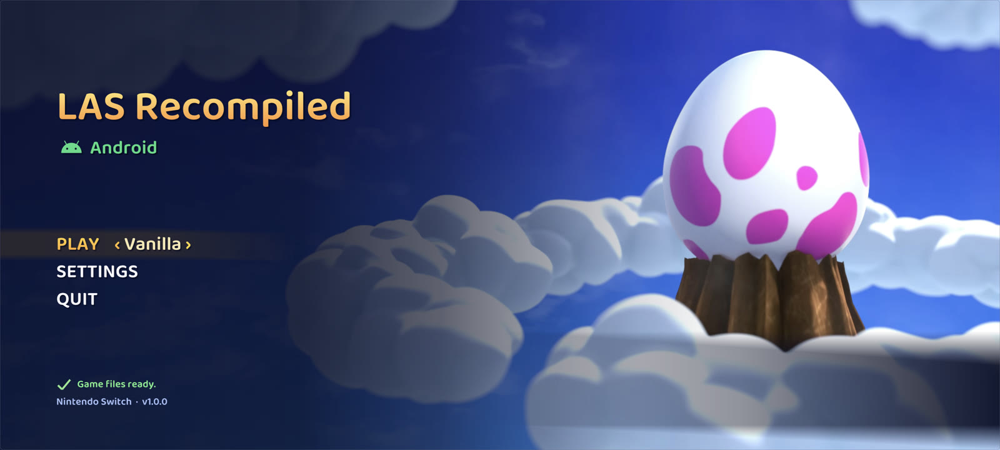
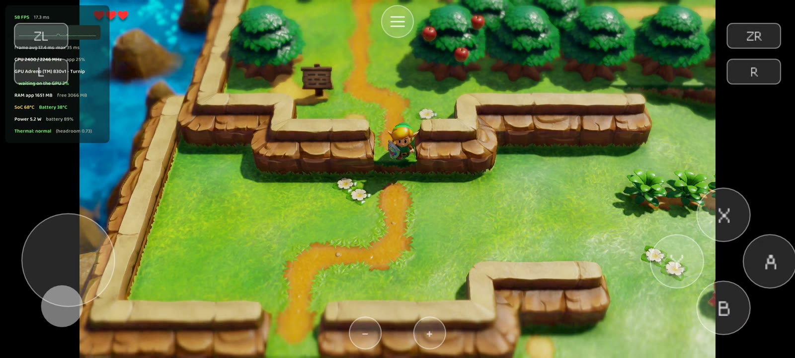
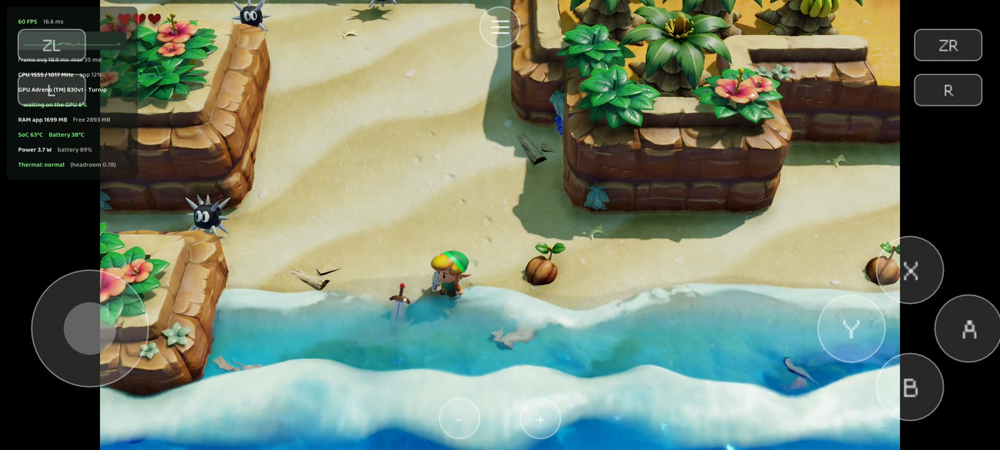
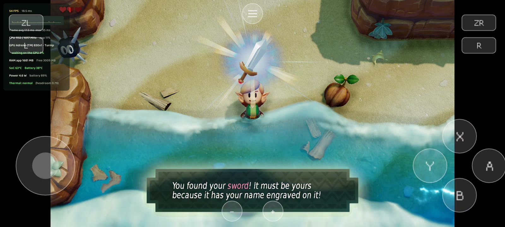
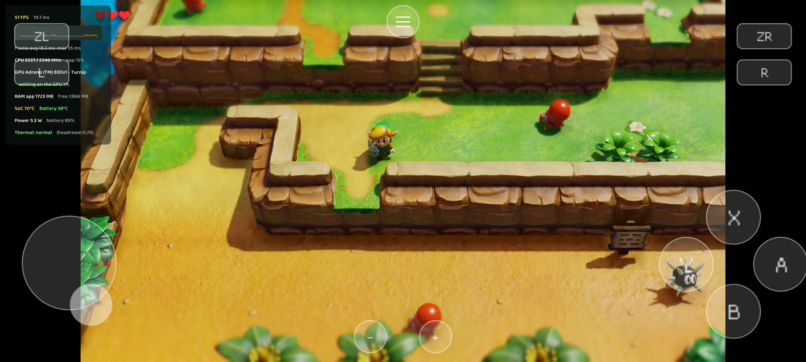
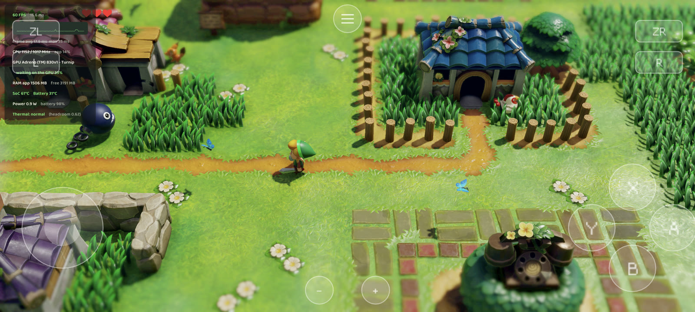
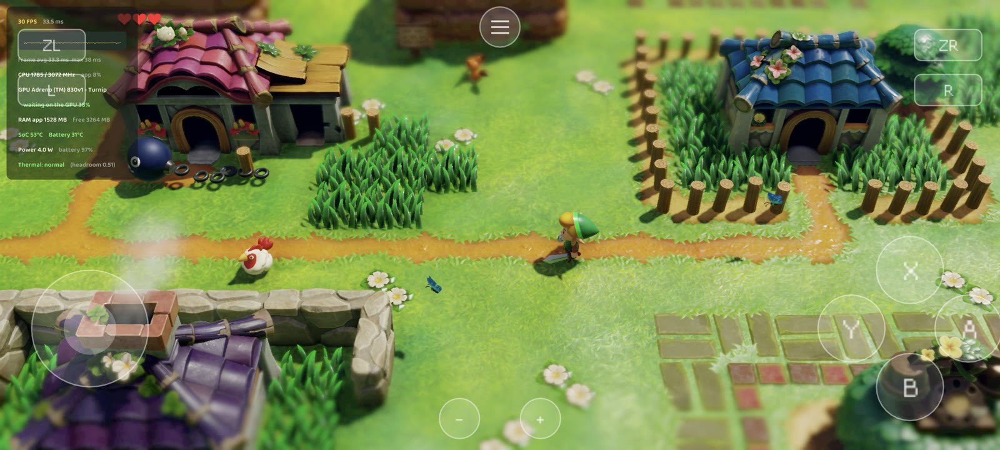

# LAS Recomp for Android

**English** | [Português](README.pt-BR.md)

An Android port of **[LAS Recomp](https://github.com/peiikai/LASRecomp)** by peiikai: a static recompilation of
*The Legend of Zelda: Link's Awakening* (Nintendo Switch, 2019). As in the original project, this is **not
emulation**: the Switch code becomes native ARM64 code, and the game's graphics (NVN) are translated to Vulkan.
For the PC versions (Windows, macOS, Linux), features and the randomizer, see the
[original repository](https://github.com/peiikai/LASRecomp).

> [!IMPORTANT]
> Like the original, this port was made almost entirely with AI: the porting work was written by Claude (Opus 5.5,
> by Anthropic, through Claude Code), directed, tested and reviewed by a human. You run the code at your own
> discretion.

> [!WARNING]
> **Experimental.** Get the APK from the [Releases](https://github.com/mamcjr/LASRecompAndroid/releases) page:
> everything else (your game files, the game code, the driver) is set up from the app, on the phone. The full plan,
> the state of each phase and the measurements are in [docs/ANDROID-PORT.md](docs/ANDROID-PORT.md) (in Portuguese).

> [!NOTE]
> **No game files are included**, and the app contains nothing from the game. You need your own legally obtained
> copy of the extracted game files of *Link's Awakening* **v1.0.0**. Instructions on how to obtain them will not be
> provided.

## Screenshots

|  |  |
|:-:|:-:|
|  |  |

On a POCO F7 Ultra with Turnip: the touch controls on screen, the performance overlay on (top left).

At 75% internal resolution (1080p) and full screen: 55-60 fps, mostly 60.

At native resolution (3200×1440, 100%) and full screen: a steady 30 fps, in the game's own 30 fps mode (full speed).

## Status

Tested on a **POCO F7 Ultra** (Snapdragon 8 Elite / Adreno 830, Android 16) with the **Turnip Gen8 V37** driver:

- the game boots, the movies play with sound, and the menus, saves and gameplay work;
- **a steady 60 fps**, the overworld included, at the default 50% internal resolution (720p): 98% of the time at 60
  in our overworld measurements, with no frame over 18 ms. At 75% (1080p) it ran at 55-60 fps in our tests, mostly 60, and at native resolution (3200×1440) full
  screen at a steady 30. The game
  still has its own 30 fps mode, as on the Switch, for when a frame can't fit;
- **touch controls**: a floating stick, A / B / X / Y, L / R / ZL / ZR, Minus / Plus and a menu button, shown while
  no controller is connected (they hide as soon as one is). Their layout can be edited (drag them where you like,
  size, opacity) in the in-game menu's Controls tab; the Android back button opens the menu;
- Bluetooth controllers (tested with a GameSir X4 Aileron), remappable in the Controls tab;
- a frame rate setting (Video tab): Auto (the game's own 30 / 60 choice), 30 fps or 60 fps;
- a performance overlay (fps, frame time, CPU, GPU, temperature, battery), and no black screen after the app comes
  back from the background. The in-game menu leaves out the desktop's options (fullscreen, 4K / 8K, randomizer).

### What made it fast

The game's shaders are translated from the Switch GPU's code to GLSL at run time. On Adreno the translated shaders
were the bottleneck, so on Android the translator now:

- resolves the control-flow stacks at translation time instead of keeping them as arrays in every shader;
- turns branches, loops and jump tables (read from the shader's own constants) into structured `if` / `for` /
  `switch` code instead of a `switch (pc)` state machine, which the mobile compiler handled poorly (the overworld's
  lighting shader went from 24 to 16-19 registers and from 2884 to 1717 instructions);
- converts half-precision values with the GPU's own instructions in fragment and compute shaders.

On the CPU side:

- **a render thread**: the game's command lists are translated to Vulkan on a thread of their own while the game
  works on its next frame, and handed to the GPU in chunks so it starts before the whole frame is translated. The
  game's thread went from ~11.4 to ~7.4 ms of work a frame;
- **the Switch's core 0, emulated**: the game runs some of its job threads on the same core as its main thread, where
  they take turns; truly parallel, a faster main thread exposed a race in its job system (a crash). Those threads now
  take turns here too, while the game's other cores stay parallel;
- **frame pacing** that tells the game's own 30 fps frames from a 60 fps frame that ran late, Android's performance
  hints aimed at 60 fps for both threads, and fixes to three thread-synchronization races in the emulated kernel;
- the runtime is built optimized, the game's GPU fences no longer wait for the compositor, and per-draw work is
  cached.

## Why the lighting needs the Turnip driver

**The game runs without Turnip**, with the phone's own Qualcomm driver: it boots, plays and saves. But its
**lighting only shows up with Turnip**. Without it, the scenes are drawn without the game's dynamic lights.

The game's shaders read and write the game's memory directly, at the same addresses the CPU uses: for example, each
frame's light list is built by a compute shader and then read by the pixel shaders. On PC, the game's memory is
imported into the GPU with `VK_EXT_external_memory_host`. Neither Qualcomm's driver nor Turnip has that extension.

**Turnip** (Mesa's open-source Vulkan driver for Adreno) has `VK_EXT_map_memory_placed`: GPU memory is allocated at
the exact address of the game's heap, so the CPU and the GPU share the same memory, with no copies. With Qualcomm's
driver, the app falls back to copies through the CPU. That is slower, and whatever a compute shader writes only gets
back to the game's memory after the GPU finishes, too late for the same frame. That is why **the lighting is broken**
with that driver.

## Current limitations

- Made for Snapdragon (Adreno GPU) with Turnip. The game runs with the phone's own driver too, but without its
  lighting. The app loads Turnip with [libadrenotools](https://github.com/bylaws/libadrenotools); the driver is not
  included, you provide your own. Other GPUs (Mali, Xclipse, ...) are untested.
- You need your own v1.0.0 dump, and about **12 GB free** for the setup (the app keeps its own copy of the game
  files plus a data image built from them); the dump itself can be deleted afterwards.
- The first setup builds the game code on the phone: about 20 minutes on a Snapdragon 8 Elite.
- Changing the resolution while the game is running can close the app. Change it on the title screen.
- No randomizer on the phone yet.

## Installing

You need a phone with a Snapdragon (Adreno) GPU, Android 11 or newer, a Turnip driver package (the adrenotools
`.zip`, as used by other emulators; the game runs without it, but the lighting only shows up with it), and your own
extracted v1.0.0 game files (the folders `exefs` and `romfs`) copied somewhere on the phone.

1. Install the APK from the [Releases](https://github.com/mamcjr/LASRecompAndroid/releases) page.
2. Open the app, tap **Game files folder** and pick the folder that holds `exefs` and `romfs` (or the folder above
   it). Android asks you to allow access to it: the app copies the files to its own folder.
3. Wait for the setup: the copy, the game data image and the game code (about 20 minutes the first time; keep the
   screen on).
4. **Settings > Prelaunch > Vulkan driver > Choose driver**: pick the Turnip `.zip`, then **Restart now**.
   Without this step the game still runs, on the phone's own driver, but without its lighting.
5. **Play**, with the touch controls or a controller. The on-screen menu button, the back button or Minus + Plus on a
   controller opens the in-game menu.

The app keeps everything in `Android/data/com.lasrecomp.android/files/`: saves, settings, the pipeline cache and the
game files. Uninstalling the app deletes that folder, saves included: copy the `save` folder out first.

## Building from source

On Windows with Git Bash, the Android SDK with **NDK 30.0.16248370** and **CMake 3.30.4**, a phone with USB
debugging, and Python 3.12. On Linux the same steps should work with bash, but they are untested there.

1. The app's dependencies (SDL3, shaderc, Vulkan-Headers, VMA, volk and the DejaVu font):
   `bash android/deps/build_deps.sh`.
2. Optional: FFmpeg, for the movies and the start screen's background. Its `configure` wants a Unix shell, so on
   Windows run it in WSL: `wsl -- bash android/deps/build_ffmpeg.sh`.
3. The game code's builder that the app carries (Python 3.14 for Android, capstone, lz4, zig):
   `bash android/deps/build_gen_deps.sh`; unicorn needs a Unix shell too: `wsl -- bash android/deps/build_unicorn.sh`.
4. The app: `cd android/lasrecomp && ./gradlew assembleRelease` (signed with your key from
   `~/.lasrecomp/keystore.properties` if it exists, else with the debug key), then
   `adb install -r app/build/outputs/apk/release/app-release.apk`, and set up as in [Installing](#installing).

For development, the game code can still be built on the PC and pushed: `bash android/build_gamelib.sh <dump>/exefs`
(with `python -m venv tools/venv` and `pip install lz4 capstone unicorn`), then
`bash android/push_game.sh <folder with exefs/ and romfs/>`.

## Credits

- **[LAS Recomp](https://github.com/peiikai/LASRecomp)** by peiikai: the recompiler, the runtime, the Vulkan renderer
  and the shader translator this port builds on. Its README credits everyone behind it, including LAS-Randomizer and
  the community mods its options re-implement.
- [SDL 3](https://libsdl.org) (zlib): window, input, audio and the Android activity.
- [libadrenotools](https://github.com/bylaws/libadrenotools) by bylaws (BSD 2-Clause): loads a custom Vulkan
  driver.
- [Mesa Turnip](https://docs.mesa3d.org/drivers/freedreno.html) (MIT): the Vulkan driver it is meant for (not
  included).
- [shaderc](https://github.com/google/shaderc) (Apache 2.0), [Vulkan-Headers](https://github.com/KhronosGroup/Vulkan-Headers)
  (Apache 2.0 / MIT), [volk](https://github.com/zeux/volk) (MIT) and
  [Vulkan Memory Allocator](https://github.com/GPUOpen-LibrariesAndSDKs/VulkanMemoryAllocator) (MIT).
- [FFmpeg](https://ffmpeg.org) (LGPL 2.1+, optional, linked dynamically): movie playback.
- The game code's builder, run on the phone: [Python](https://www.python.org) 3.14 (PSF license),
  [Zig](https://ziglang.org) 0.17 (MIT), [Capstone](https://github.com/capstone-engine/capstone) 5.0.9 (BSD 3-Clause),
  [Unicorn](https://github.com/unicorn-engine/unicorn) 2.1.4 (GPL 2.0; its unmodified source:
  [2.1.4](https://github.com/unicorn-engine/unicorn/archive/refs/tags/2.1.4.tar.gz), built by
  `android/deps/build_unicorn.sh`) and [LZ4](https://github.com/lz4/lz4) 1.10.0 (BSD 2-Clause).
- [Dear ImGui](https://github.com/ocornut/imgui) (MIT): the overlay menu and the start screen.
- [SMAA](https://github.com/iryoku/smaa) and [AMD FidelityFX Super Resolution 1](https://github.com/GPUOpen-Effects/FidelityFX-FSR)
  (MIT): the anti-aliasing and upscaler options, built into the renderer.
- The Android robot on the start screen is reproduced or modified from work created and shared by Google and used
  according to terms described in the [Creative Commons 3.0 Attribution License](https://creativecommons.org/licenses/by/3.0/).
- [DejaVu fonts](https://dejavu-fonts.github.io) (Bitstream Vera license): stand-in for the Switch's system font.

## Legal

This is a fan project. It is not affiliated with, endorsed by or sponsored by Nintendo. *The Legend of Zelda* and
*Link's Awakening* are trademarks of Nintendo. No game files, game code, assets or fonts are included, in this
repository or in any build. You must provide your own legally obtained copy of the game files to play.

## License

The code is open source under the [MIT License](LICENSE), as in the original project. Third-party components keep
their own licenses (above, and in the [original README](https://github.com/peiikai/LASRecomp#license)). The license
covers this project's code only: it grants nothing for Nintendo's game, which you must supply yourself.
